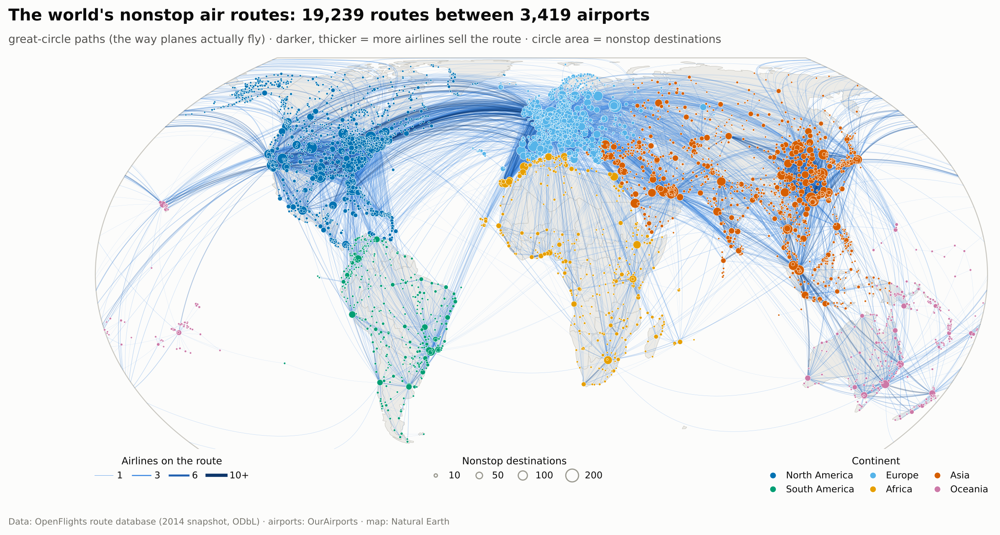
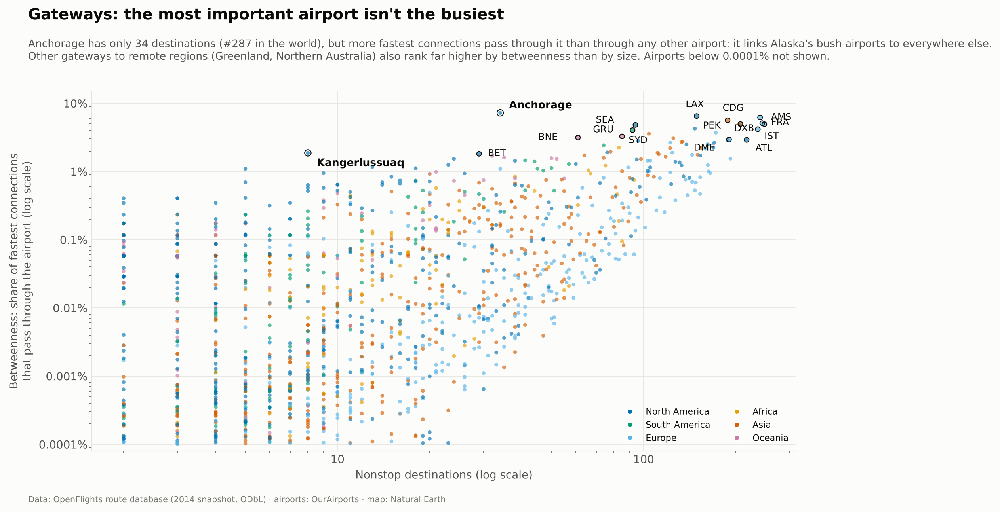
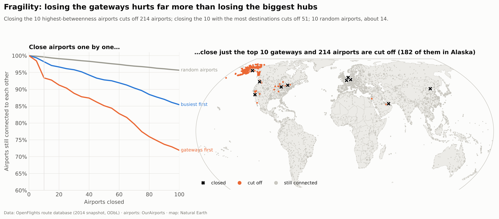
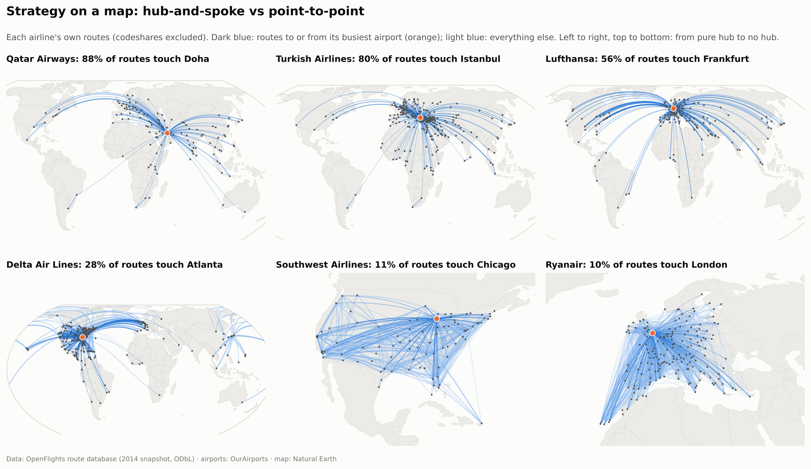
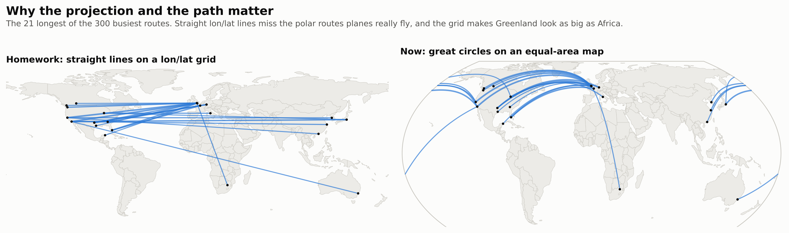

# Four flights from almost anywhere

A network analysis of the world's air routes: **3,419 airports, 19,239 nonstop routes, 501 airlines**. It looks at
which airports hold the network together, how few flights separate any two places, and what breaks when the wrong
airports close. Built with Python (pandas, NetworkX, Matplotlib, PyQt) and D3.

**[▶ Read the interactive story](https://saakshhh.github.io/flight-network/)** ·
**[Explore the network yourself](https://saakshhh.github.io/flight-network/explore.html)**



## What I found

1. **A handful of hubs carry the network.** The median airport has nonstop flights to just **3** destinations, and
   44% have two or fewer. The top 5% of airports (171) are an endpoint of **70% of all routes**. Amsterdam (248
   destinations), Frankfurt (244) and Paris CDG (240) lead.
2. **It's a small world.** Across every pair of connected airports, the fastest connection takes **4.1 flights** on
   average; 69% of pairs are 4 flights or fewer apart and 96% are 6 or fewer. From Chicago O'Hare, 3,015 of 3,391
   airports (89%) are within three flights. The worst case is **13 flights**, from Lopez Island (WA) to Salluit
   (QC), because both sit at the end of chains of tiny regional airports.
3. **The most important airport isn't the busiest: it's Anchorage.** By *betweenness* (the share of all fastest
   connections that pass through an airport), #1 is Anchorage, with only **34 destinations (#287 by size)**. It is
   the only link between Alaska's bush airports and everywhere else. Kangerlussuaq in Greenland (8 destinations)
   ranks #38 for the same reason.
4. **Losing the gateways hurts more than losing the biggest hubs.** Close the 10 highest-betweenness airports and
   **214 airports are cut off** (182 in Alaska). Closing the 10 with the most destinations cuts off 51, and 10 random
   airports about 14. Big hubs back each other up; gateways have no backup.
5. **Airline strategy shows up on the map.** Qatar Airways and Emirates route **88%** of their routes through their
   home hub. Ryanair (10%) and Southwest (11%) have no real hub, and US network carriers sit in between (Delta: 28%
   at Atlanta).
6. **The network draws its own regions.** Community detection finds 19 groups that mostly match continents, with
   telling exceptions: India joins the Gulf hubs rather than Asia, and Alaska, Northern Canada and Greenland are
   each separate worlds.







## The visualizations

| What | Shows | Command |
|---|---|---|
| Route map | Every route (or the top N, or one airline's) as great circles; airports sized by destinations, colored by continent or by number of airlines | `python -m flightnet.routemap [--top 200] [--airline EK] [--straight] [--projection lonlat]` |
| Desktop explorer | PyQt window: hover tooltips, click an airport to focus on it, sliders for minimum destinations and airlines per route, airline filter, airport search, great-circle and projection toggles | `python -m flightnet.app` |
| Analysis charts | `hubs`, `reach`, `gateways`, `fragility`, `airline-maps`, `airline-strategy`, `regions`, `compare` | `python -m flightnet.charts gateways --show` |
| Story website | The findings as a scrolling story with a spinning globe and a "how many flights from…" map; every number comes from `flightnet/stats.py` | `python -m flightnet.site` → `docs/index.html` |
| Web explorer | Zoomable map: any airport's routes, any airline's network, and the fastest itinerary between two airports (fewest flights, then fewest km). Views are shareable as URLs, e.g. [`#from=LPS&to=YZG`](https://saakshhh.github.io/flight-network/explore.html#from=LPS&to=YZG) | `docs/explore.html` |

Regenerate every figure and the website with `python -m flightnet.figures`. Print every statistic quoted above with
`python -m flightnet.stats`.

## Design choices

- **Great circles on an equal-area map.** The homework drew straight lines on a lon/lat grid. That misses the polar
  routes planes really fly and makes Greenland look as big as Africa. Routes are now WGS84 geodesics
  (`geographiclib`), split where they cross the date line, on an **Equal Earth** projection implemented in a few
  lines of NumPy (`flightnet/geo.py`), so there's no cartopy/GDAL install.

  

- **Measure what the data can support.** OpenFlights has no flight frequencies or seat counts. The course data's
  "number of flights" was actually a count of route listings (airline × direction). Routes here are weighted by the
  number of **airlines selling them**, and the charts say so.
- **Honest encodings.** Airport circle *area* grows linearly with destinations, and big circles are drawn first so
  small ones stay visible. Routes use one sequential blue ramp, with busier routes darker, thicker and drawn on top.
  Continents use the colorblind-safe Okabe–Ito palette.
- **Network measures that answer a question.** Degree finds the hubs, betweenness finds the gateways, and removal
  curves test which ones matter. Random removal is averaged over 20 runs so it's a fair baseline.
- **Every number is computed, never typed.** The story page is a template filled from `flightnet/stats.py`, so the
  text can't drift from the data. The farthest-itinerary path uses the same rule (fewest flights, then fewest km) in
  Python and in the browser.

## Data

Routes, airports and airlines come from [OpenFlights](https://openflights.org/data) (ODbL), with continents and
missing airports from [OurAirports](https://ourairports.com/data/) and country outlines from
[Natural Earth](https://www.naturalearthdata.com/). `scripts/build_dataset.py` turns them into four tidy tables in
[`data/`](data/). See [`data/README.md`](data/README.md) for the column dictionary and the fixes. The biggest fix: the
raw route file mislabels airlines that share a code (Vueling's routes are tagged *Formosa Airlines*), so each code
is matched to the airline whose home country its routes actually serve.

**Caveat:** the OpenFlights route data is a **2014 snapshot** and isn't maintained anymore, so it describes the
network as it was then (for example, Istanbul's main airport was still Atatürk).

## Run it yourself

```bash
git clone https://github.com/saakshhh/flight-network.git
cd flight-network
pip install -r requirements.txt
python -m flightnet.app          # desktop explorer
python -m flightnet.figures      # rebuild every figure + the website (~1 min the first time)
```

The website opens straight from disk (`docs/index.html`); it loads D3 from a CDN.

## Project structure

```
├── data/                 tidy tables built from OpenFlights + OurAirports, world map, build report
├── docs/                 the website (GitHub Pages): index.html story, explore.html explorer, assets/
├── figures/              PNGs used in this README and on the site
├── flightnet/
│   ├── data.py           loading, filtering, the network as a NetworkX graph
│   ├── geo.py            Equal Earth projection, great circles, date-line splitting
│   ├── network.py        hop distances, removal curves, airline strategy, communities
│   ├── stats.py          every number quoted in the README and on the site
│   ├── maps.py, style.py shared map drawing and visual style
│   ├── routemap.py       static route map CLI
│   ├── charts.py         analysis charts
│   ├── app.py            PyQt desktop explorer
│   ├── site.py, web/     website builder and templates
│   └── figures.py        regenerate everything
└── scripts/build_dataset.py
```

This project grew out of a homework assignment in Purdue's CS 43900 Interactive Data Visualization course
(geospatial maps, visual attributes, tooltips, filtering and geodesic routes). It was rebuilt from the original
public data, with a cleaned dataset, network analysis, and a web version.
